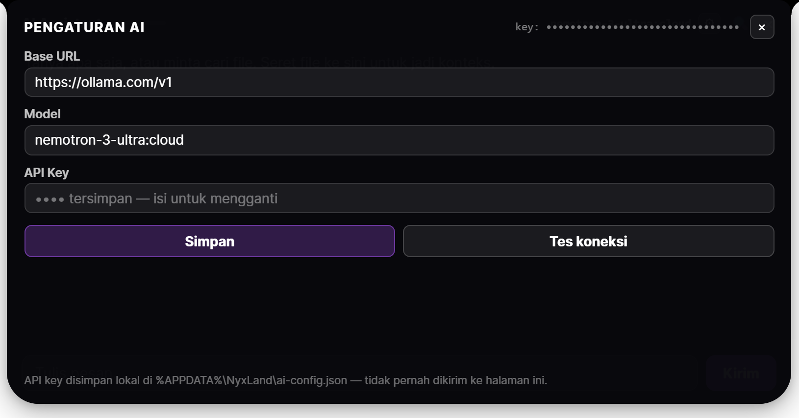

# NyxLand

Dynamic Island untuk Windows. Nempel di atas layar, ringkas, dan bisa dipanggil kapan saja.

Dibangun di atas Electron + React, dengan serangkaian fitur yang tumbuh dari pemakaian harian: notifikasi sistem, reminder, audio mixer, catatan cepat, sampai AI Assistant yang bisa baca file di komputermu.



---

## Fitur

### Island & Notifikasi
- **Notch mode** — 170×40 px, nempel di atas layar, nggak ganggu
- **Expand / collapse** — `Alt+N` buka, `Esc` kecilkan lagi
- **Notifikasi Windows** — masuk ke island, lengkap dengan app name dan aksi
- **Sound** — nada berbeda per jenis (notifikasi biasa vs alarm tugas)
- **Click-through** — island nggak ngeblok klik ke jendela di belakangnya

### Reminder & Tugas
- Ketik `minum obat @+15m` atau `meeting @14:30` — waktu otomatis kebaca
- Banner di notch + kartu popup + chip hitung mundur
- Tombol **Tunda 5m** dan **Selesai**
- Bunyi alarm dua tahap (peringatan awal + waktunya)

### AI Assistant
- Chat dengan model apa saja lewat API OpenAI-compatible
- **Base URL, Model, API Key diatur sendiri** dari dalam app (⚙ di header tab AI)
- **Drag & drop file/folder** langsung ke panel — isi file ikut jadi konteks
- **Context window** dijaga: 40 pesan disimpan, 9.000 karakter dikirim
- Hapus per-pesan, hapus semua (dengan undo 8 detik), dan cari pesan

### Tampilan
- **Background image** — URL remote, link Google Images, path lokal (`C:\...`), atau pilih file lewat tombol 📁
- Preview langsung di Settings, border merah kalau URL-nya bukan gambar
- Theme: Default, Sleek Black, Win95, Invisible
- Warna island & warna teks bisa diatur

### Lainnya
- **Audio Mixer** — volume per aplikasi
- **Quick Notes** — catatan cepat, bisa langsung jadi tugas
- **Calendar, Weather, Battery Hub, Now Playing**
- **Progress Island** — progress bar universal
- **Shortcut tab** — `Alt+W/O/M/C/N/G/T/...` (bisa diubah)

---

## Instalasi

### Pakai installer (paling gampang)

1. Buka [Releases](../../releases)
2. Unduh `NyxLand-Setup-<versi>.exe`
3. Jalankan, ikuti wizard-nya

> Windows mungkin nampilin "Windows protected your PC" karena installer-nya belum di-sign. Klik **More info → Run anyway**.

### Dari source

```bash
git clone https://github.com/<username>/NyxLand.git
cd NyxLand
npm install
npm start
```

---

## Setup AI Assistant

Tab **AI Assistant** → tombol **⚙** di kanan atas.

| Field | Contoh | Keterangan |
|---|---|---|
| Base URL | `https://ollama.com/v1` | Endpoint OpenAI-compatible |
| Model | `llama3.1:8b` | Nama model di provider-mu |
| API Key | `sk-...` | Disimpan lokal, nggak pernah dikirim ke halaman |

Tekan **Tes koneksi** buat mastiin kredensialnya jalan.

Contoh provider:
- **Ollama Cloud** — `https://ollama.com/v1`
- **Ollama lokal** — `http://localhost:11434/v1` (API key boleh dikosongkan... isi apa saja)
- **OpenAI** — `https://api.openai.com/v1`
- **OpenRouter** — `https://openrouter.ai/api/v1`
- **Groq** — `https://api.groq.com/openai/v1`

### Soal keamanan API key

- Disimpan di `%APPDATA%\NyxLand\ai-config.json`, permission `0600` (owner-only)
- **Tidak pernah** masuk ke bundle aplikasi
- **Tidak pernah** dikirim balik ke renderer — yang ditampilkan cuma mask (`1cc3••••Fk7h`)
- Folder `ai-config.json` nggak ikut ke repo (lihat `.gitignore`)

---

## Shortcut

| Tombol | Fungsi |
|---|---|
| `Alt+N` | Buka island (large) |
| `Esc` | Kecilkan ke notch / tutup popup |
| `Alt+W` | Weather |
| `Alt+O` | Overview |
| `Alt+M` | Now Playing |
| `Alt+C` | Calendar |
| `Alt+G` | Game / Stats |
| `Alt+T` | Tasks |
| `←` / `→` | Pindah tab |

Semua bisa diubah di **Settings → Shortcuts**.

---

## Build sendiri

```bash
npm install
npm run make        # butuh electron-forge
```

Output ada di `out/make/`.

Untuk build ringan (tanpa `node_modules` di dalam asar):

```bash
npm run pack:slim
```

---

## Struktur repo

```
NyxLand/
├── app/                  # payload runtime (yang masuk app.asar)
│   ├── .vite/
│   │   ├── build/        # main.js, preload.js, services
│   │   └── renderer/     # UI bundle
│   └── src/              # ai-agent, services, assets
├── scripts/
│   ├── pack.mjs          # bikin app.asar
│   └── verify-nokey.mjs  # scan bundle: pastikan nggak ada API key
├── docs/
└── README.md
```

---

## Verifikasi sebelum rilis

```bash
node scripts/verify-nokey.mjs
```

Script ini nyisir seluruh `app/` dan `app.asar` buat mastiin nggak ada string yang mirip API key, dan nggak ada `ai-config.json` yang ikut kebundel.

---

## Lisensi

MIT — lihat [LICENSE](LICENSE).

---

## Kredit

Dibuat oleh Ahmad Faqod Kurnia.

Basis awal: proyek Dynamic Island untuk Windows (MIT).
